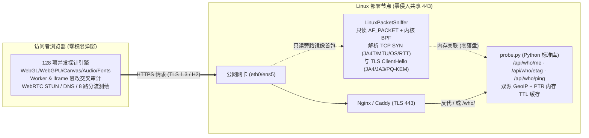

# WhoProbe · 全栈浏览器与网络伪装透视探针 (L3–L7)

[](./LICENSE)
[-3776AB.svg)](./probe.py)
[](#7-大观测层与-128-项真实探针)
[](#18-项伪装与反关联交叉审判)

> **WhoProbe** 是一款**零第三方 Python 依赖**的全栈（L3 网络层 → L4 传输层 → TLS 握手层 → HTTP 协议层 → 浏览器硬件/图形/JS 运行时）指纹与代理伪装自检工具。
>
> **English Summary**: A zero-dependency Python + vanilla JS L3–L7 browser & network fingerprint / proxy-disguise inspector. Features passive Linux `AF_PACKET` BPF sniffing (`TCP SYN` TTL/Window/MSS/MTU/Options/`JA4T`/OS + `SYN→ClientHello` physical handshake RTT + raw `TLS ClientHello` `JA4`/`JA3`/GREASE/`X25519MLKEM768` PQ-KEM/ECH/ALPS) without modifying or replacing your existing Nginx 443 service, paired with 128 zero-permission client/server probes and 18 cross-layer anti-detect checks.

---

## 为什么做 WhoProbe？

常规「查看我的 IP」或纯前端指纹网页只能看到表层 HTTP IP 或单侧 JS 参数，无法还原**严苛风控系统（如 Cloudflare Turnstile、DataDome、Stripe Radar、各大 AI 平台与跨境电商反欺诈引擎）**在打开网页几百毫秒内的真实交叉判定：

1. **零侵入旁路抓包，直接看穿代理代发连接**：在 Linux 服务端通过只读 `AF_PACKET` + 内核 BPF 过滤器旁路嗅探 443 端口握手包——无需替换现有 Nginx，也不影响同机其他业务，即可直接提取首个 `TCP SYN` 的初始 TTL、窗口、MSS/MTU、`JA4T` 传输指纹，以及 `TLS ClientHello` 的 `JA4` / `JA3` / 后量子密钥交换 `X25519MLKEM768` / `ECH` / `ALPS`。当浏览器自报 `macOS` 或 `Windows`，而发包内核暴露 `Linux (TTL=64)` 时，一眼识别节点代发连接。
2. **物理握手延迟 vs 浏览器 HTTP RTT 差值测距**：同时测量「代理出口 → 服务端」的内核 `SYN → ClientHello` 物理握手耗时与「用户设备 → 代理节点 → 服务端」的浏览器 `ResourceTiming` HTTP 往返耗时，直接量化代理中转多绕的物理路程。
3. **8 路国内外与 AI 平台分流矩阵**：并发探测本站直连、中国大陆测速节点、国际 GeoIP、OpenAI ChatGPT 边缘、Anthropic Claude 边缘、Cloudflare 边缘、随机子域名递归 DNS 出口与 IPv4/IPv6 双栈独立出口，精准抓出「规则分流漏出国内真实宽带」与「IPv6 直连裸奔」。
4. **52+ 项反指纹插件与容器/自动化谎言审计**：交叉验证 `Function.prototype.toString`、属性描述符、Worker 独立线程与主线程对比、空白 `iframe` 洁净环境对比、Canvas/Audio 二次采样噪声注入、WebGL GPU 参数与 OS 物理矛盾（如自称 macOS 却暴露 Direct3D11 / SwiftShader / Docker 低共享内存特征）。
5. **双场景审计 + 逐项「怎么改」修复指南**：支持切换 **「装成当地真人（防代理/分流穿帮）」**（支持自选目标伪装地区）与 **「反追踪防关联（纯看隐私暴露）」** 两种评分逻辑，每一处破绽均附带通俗原理与可落地的修复步骤，并支持单条目独立重测。

---

## 架构概览



---

## 10 秒快速启动（零依赖）

后端仅使用 **Python 3.10+ 标准库**，前端已预编译内置 **Tailwind CSS v4 + Preline UI v5**，无需安装 `pip` 包或 `Node.js` 即可直接运行：

```bash
git clone https://github.com/zzusec/whoprobe.git
cd whoprobe

# 1. 运行内置自动化自检（验证 TCP/JA4T 解析器、ETag 探针与 HTTP 接口）
python3 probe.py --self-test

# 2. 启动本地服务（默认监听 http://127.0.0.1:8899）
python3 probe.py --host 0.0.0.0 --port 8899
```

浏览器打开 `http://127.0.0.1:8899` 即可体验完整界面（同时原生兼容 `http://127.0.0.1:8899/who/` 子路径挂载）。

> **提示**：在 macOS 或普通无特权模式下运行时，`probe.py` 会自动优雅回退至基础 Socket/反向代理头模式，其余浏览器端、多路由分流、DNS、WebRTC、硬件与反篡改探针全部正常工作；在 **Linux 服务器配合 `--sniff-iface` 与 `CAP_NET_RAW`** 部署时，将完整解锁底层 `TCP SYN (JA4T / OS / MTU / 握手 RTT)` 与 `TLS ClientHello (JA4 / JA3 / PQ-KEM / ECH)` 协议栈透视能力。

---

## 生产环境部署指南（Linux 旁路抓包 + Nginx 共享 443）

推荐在海外 Linux 云服务器（Ubuntu / Debian / Rocky / Arch）上部署，通过最小权限 `CAP_NET_RAW` 开启只读旁路嗅探，并用现有 Nginx 反向代理 `/` 或 `/who/` 子路径：

### 1. 部署代码与专用低权限系统用户

```bash
sudo git clone https://github.com/zzusec/whoprobe.git /opt/whoprobe
sudo useradd --system --no-create-home --shell /usr/sbin/nologin whoprobe
sudo chown -R whoprobe:whoprobe /opt/whoprobe
```

### 2. 配置 Systemd 服务（开启 `CAP_NET_RAW` 旁路抓包）

先查看服务器公网网卡名称（例如 `eth0` 或 `ens5`）：

```bash
ip route show default
# 示例输出: default via 172.31.0.1 dev ens5 ... -> 网卡名为 ens5
```

复制并启用仓库自带的 [`deploy/who-probe.service`](./deploy/who-probe.service)（将 `--sniff-iface` 改为你的实际网卡名）：

```bash
sudo cp /opt/whoprobe/deploy/who-probe.service /etc/systemd/system/who-probe.service
sudo sed -i 's/--sniff-iface eth0/--sniff-iface ens5/' /etc/systemd/system/who-probe.service
sudo systemctl daemon-reload
sudo systemctl enable --now who-probe

# 查看运行状态，确认输出 "[sniffer] 已挂载只读 BPF 探针"
sudo systemctl status who-probe
```

### 3. 配置 Nginx 反向代理

参考 [`deploy/nginx-example.conf`](./deploy/nginx-example.conf)，支持两种挂载方式：

- **同域名子路径隔离挂载（如 `https://example.com/who/`）**：不影响该域名根路径 `/` 上已有的任何网站或业务；
- **独立二级域名挂载（如 `https://who.example.com/`）**。

测试并重载 Nginx：

```bash
sudo nginx -t && sudo systemctl reload nginx
```

---

## Docker 部署

### 方式一：标准容器模式（快速体验）

```bash
docker compose up -d whoprobe
# 访问 http://localhost:8899
```

### 方式二：Host 网络 + `NET_RAW` 模式（开启宿主机 443 旁路抓包）

若宿主机 443 端口运行着 Nginx/Caddy，可通过 `host` 网络模式 + 只读 `NET_RAW` 能力抓捕真实外部客户端握手包：

```bash
SNIFF_IFACE=ens5 docker compose --profile sniffer up -d whoprobe-sniffer
```

---

## 7 大观测层与 128 项真实探针

| 观测分层 | 探针数 | 核心检测项代表 |
| :--- | :---: | :--- |
| **1. 服务端与协议栈透视 (`net`)** | 24 | 出口 IP、双源地理位置与坐标、ASN/ISP、机房/家宽/蜂窝/Relay 判定、出口时区、PTR 反解、`TCP SYN→TLS` 物理握手耗时 vs 浏览器 HTTP RTT、时钟偏差、HTTP/TLS 协商套件、被动 TCP SYN 操作系统推断、`JA4T` 传输指纹、链路 MTU 与 WireGuard/TUN 隧道特征、`JA4` / `JA3` + GREASE、ALPS & Brotli 证书压缩、`X25519MLKEM768` 后量子密钥交换、`ECH`、HTTP 请求头序签名、QUIC/HTTP3、递归 DNS 出口、WebRTC STUN 公网/内网 mDNS、IPv6 EUI-64 网卡 MAC 泄露 |
| **2. 多路由分流与双栈矩阵 (`exit`)** | 8 | 本站直连出口、中国大陆网站出口、国际 GeoIP 出口、OpenAI ChatGPT 边缘出口、Anthropic Claude 边缘出口、Cloudflare 全球边缘出口、Cloudflare WARP / Gateway 检测、IPv4 与 IPv6 双栈独立出口对照 |
| **3. HTTP 原始请求头与高熵提示 (`hdr`)** | 9 | 原始 `User-Agent` / `Accept-Language` / `Accept-Encoding`、`Sec-Fetch-*` 元数据、Client Hints 低熵与高熵架构/位数/平台真实版本号、DNT 与 GPC 隐私信号 |
| **4. 语言、时区与输入法区域 (`loc`)** | 12 | `navigator.languages` 序列、IANA 时区、冬夏令时历史偏移曲线（区分同 UTC 偏移的不同地区）、12/24 小时制、Intl 默认区域/数字/货币/日历系统、输入法物理键位布局 (`Keyboard.getLayoutMap`)、系统内置离线 TTS 语音包语种归属、字体生态反推语言圈 |
| **5. 硬件规格、图形栈与多媒体 (`dev`)** | 34 | 平台与 CPU 线程、JS 堆内存与 RAM 档位、CSS 逻辑视口与 DPR 反算物理分辨率、P3/Rec2020 广色域与 HDR、VSync 刷新率实测、WebGL 双显卡 Vendor/Renderer、硬件上限哈希、抗锯齿与着色器精度、WebGPU 适配器架构与 Limits、多点触控与指针形态、电池状态、虚拟摄像头/OBS 设备槽位、WebCodecs/MediaCapabilities 硬解 (AV1/HEVC/VP9)、WASM SIMD、V8/SpiderMonkey/JavaScriptCore 引擎特征与自动化补丁框算 |
| **6. 浏览器偏好、扩展与反篡改 (`brw`)** | 28 | 深浅色/对比度/减弱动画偏好、PDF 内置阅读器、Cookie/Storage 配额（识别无痕模式压缩配额）、ServiceWorker/IndexedDB/OPFS、剪贴板/通知/定位权限状态、Web Bluetooth/USB/HID/Serial/MIDI、AdBlock 诱饵实测、常见 Chrome 扩展 `chrome-extension://` 公开资源扫描、WebDriver、52 项原生原型链 `toString`/描述符审计、Canvas/Audio 二次采样噪声检测、Worker 独立线程对照、空白 `iframe` 洁净环境对照、DevTools 侧边栏占宽 |
| **7. 跨站指纹与无痕留痕追踪 (`fp`)** | 13 | 全维度综合稳定指纹、跨浏览器物理硬件指纹码（Chrome 与 Safari 打开亦相同）、Canvas 2D 混合几何渲染哈希、WebGL 离屏 3D 着色像素哈希、OfflineAudioContext 浮点振荡器哈希、62 款代表性字体宽高度量哈希、亚像素排版与 Emoji 轮廓哈希、Math 超越函数精度签名、Error Stack 格式签名、无状态 HTTP `ETag` 缓存重识别（清 Cookie 仍可认出）、LocalStorage 跨刷新留痕、TLS 会话复用状态 |

---

## 18 项伪装与反关联交叉审判

右侧审计面板对采集到的 128 项信号进行跨层逻辑比对，支持点击任意条目展开修复方案或单独重测：

1. **系统时区 vs 出口 IP 时区**（含目标伪装国一致性校验）
2. **浏览器首选语言 vs 出口国家语系**（及 `HTTP Accept-Language` 头与 JS 读数一致性）
3. **系统离线 TTS 语音包 & 本机特色字体 vs 出口区域**（抓捕中文字体/中文语音包残留）
4. **递归 DNS 解析器国家 vs 代理出口国家**（抓捕 DNS 泄露）
5. **国内外、AI 平台与双栈 8 路分流一致性**（抓捕绕过大陆规则暴露国内宽带及 IPv6 裸奔）
6. **TCP 协议栈被动 OS 指纹 & MTU vs User-Agent 自报系统**（抓捕 Linux 代理节点代发连接与 WireGuard/TUN 封装）
7. **服务端 TCP 物理握手耗时 vs 浏览器 HTTP 往返延迟**（抓捕跨国代理中转绕路差值）
8. **TLS `JA4`/`JA3`、GREASE、ALPS 与后量子密钥交换真实性**（识别脚本库或中间人 HTTPS 解密工具）
9. **WebRTC STUN UDP 公网候选与内网地址暴露**
10. **出口 IP 机房 / Hosting / 云厂商 ASN 属性识别**
11. **原生 API 原型篡改、Canvas/Audio 加噪、Worker/iframe 环境分裂审计**
12. **无头浏览器、自动化框架 (Playwright/Puppeteer/CDP) 与 Docker/云手机容器痕迹**
13. **WebGL 渲染器与操作系统物理合理性校验**（如 macOS 出现 Direct3D11 或 SwiftShader 软渲染）
14. **无状态 HTTP `ETag` 缓存跨清 Cookie 重识别验证**
15. **屏幕视口、多显示器坐标与远程桌面/虚拟机非标分辨率特征**
16. **硬件并发核数、内存档位与设备定位合理性**
17. **广告拦截器与浏览器扩展特征暴露**
18. **综合唯一性与防关联风险评级（A ~ F 级）**

---

## 二次开发与前端样式重编译（可选）

仓库已提交编译压缩好的 [`static/style.css`](./static/style.css)，直接部署无需 Node.js。如果你修改了 [`static/index.html`](./static/index.html) 或 [`static/app.js`](./static/app.js) 中的 Tailwind CSS 类名，可按需重编译样式：

```bash
npm install
npm run build:css
npm test
```

### 命令行参数说明

```text
usage: probe.py [-h] [--host HOST] [--port PORT] [--sniff-iface SNIFF_IFACE]
                [--sniff-port SNIFF_PORT] [--self-test]

options:
  --host HOST               监听地址 (默认 127.0.0.1)
  --port PORT               监听端口 (默认 8899)
  --sniff-iface SNIFF_IFACE 可选 Linux 网卡名(如 ens5/eth0)，开启只读旁路 TCP SYN/JA4 抓包
  --sniff-port SNIFF_PORT   旁路抓包目标端口 (默认 443)
  --self-test               运行内置自动化自检后退出
```

### 后端 HTTP 接口

| 路径（同时支持 `/who` 前缀） | 说明 |
| :--- | :--- |
| `GET /` 或 `GET /who/` | 前端主界面（自动下发 `Accept-CH` 高熵 Client Hints 请求头） |
| `GET /api/who/me` | 返回客户端 IP、双源 GeoIP/ASN/PTR、Nginx TLS 协商元数据、HTTP 原始头序及旁路抓包捕获的 `packet.tcp` (`JA4T`/TTL/MTU/握手 RTT) 与 `packet.tlsClientHello` (`JA4`/`JA3`/GREASE/PQ-KEM/ECH) |
| `GET /api/who/etag` | 零数据库无状态 HTTP `ETag` / `If-None-Match` 缓存留痕演示接口 |
| `GET /api/who/ping` | 轻量级 HTTP 往返延迟与服务端毫秒时钟校准接口 |

---

## 隐私与安全声明

- **零持久化日志**：[`probe.py`](./probe.py) 不连接任何数据库、不写访问日志文件；旁路嗅探到的 TCP/TLS 握手元数据与 GeoIP 查询结果仅保存在定长内存 `TTLCache`（数分钟自动淘汰）中用于当前页面回显。
- **本地交叉计算**：所有浏览器硬件指纹与服务端网络数据的交叉比对均在访问者当前浏览器内存中完成。
- **合规用途**：本项目仅供网络安全研究、反欺诈风控原理解析、跨境网络排障及个人隐私暴露面自检使用，请勿用于非法追踪他人。

---

## License

本项目基于 [MIT License](./LICENSE) 开源。
