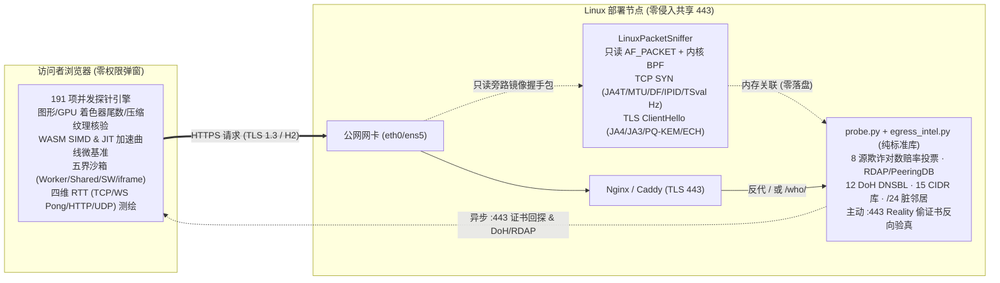

# WhoProbe v7.9 · 网站能看到什么

首页「网站能看到什么」以**加载这一页的 HTTP 导航**为样本：展示本站应用收到的请求、网络对端、可信入口协商的协议，以及能关联到同一连接的抓包。区分浏览器脚本可读、第三方情报推断和未测项；分流环境下，不同网站见到的地址可能不同。

Cookie、认证头、ETag、URL 查询值都不回显，来源网址只保留 origin；原始收据和主动联测结果不进入公开分享快照。点「发送探针请求」会另发不带 Cookie 的请求，不覆盖原始导航收据。

无需配置即可在首页「页面脚本能读取」看到两项原导航观测：浏览器记录的 HTTP 协议族与本站入口是否一致，以及文档正文解码前、后的字节数（不含请求头或协议开销）。两项都读取当前页面，没有额外请求；手动发送探针也不会替换原导航。缓存、Service Worker 或已识别的 Cloudflare 回源不用于证明两端使用了相同协议。浏览器未提供的读数显示为未测，不补成 HTTP/2 或 0 毫秒。

多目标分流至少需要两个独立有效样本，结果限于已测目标。递归 DNS 的估算地区不等于设备位置；ECS 只说明该次查询携带的子网信息。STUN 对照限于同地址族的公网 UDP 反射候选；主机、中继、mDNS 候选以及另一地址族不证明本站 HTTP 出口泄漏。IPv6 符合 EUI-64 格式也不能确定是本机物理网卡。

### 可选：配置自己的对照端点

这些探针仅在用户点击后运行；不配置时，收据和现有探针库仍可用。请在自有或已获授权的网络、域名与服务上配置。

| 联测 | 配置和证据 |
| --- | --- |
| 双栈与实际 HTTP/3 | `--visibility-ipv4-url`、`--visibility-ipv6-url`、`--visibility-h2-url`、`--visibility-h3-url` 支持分别指向自有 `https://…/api/who/visibility/sample`（兼容 `/who/`）。IPv4-only 与 IPv6-only 主机分别发布 A 与 AAAA；H3 目标需真正终止 HTTP/3，向后端透传 `$server_protocol` 与 ALPN，由完整 HTTP 响应证明可达。首包到达、Alt-Svc 广告和回退均不是 H3 成功。跨源目标在其后端配置 `--visibility-origin https://主测站`，不要配置通配 CORS 或加凭证。 |
| 自有权威 DNS | 将专用测量子域委派给自有 NS。使用 `--visibility-dns-zone`、`--visibility-dns-ns`（区外 NS 名称）、`--visibility-dns-bind`、`--visibility-dns-port`（默认 53）及 `--visibility-dns-a` / `--visibility-dns-aaaa` 指定 HTTPS 目标。开放该 NS 的 UDP/TCP 53；与 HTTPS 目标地址独立。为该区准备通配 HTTPS 证书并将采样路径反代到 WhoProbe；可用 `--visibility-dns-acme-cname` 将固定 `_acme-challenge` 名称委派到区外 DNS-01 验证名。公网解析器能看到一次性查询名，但读回报告的私有凭证是另一随机值。仅观察递归端来源、QTYPE 和最细 `/24` 或 `/56` 的 ECS，不判断客户端到解析器是否使用 DoH。 |
| WebRTC 中继 | `--visibility-turn-url turn[s]:…` 只配置自有 TURN 地址，不包含凭证。用户按需输入短期凭证，页面做 WebRTC DataChannel 往返后读选中的 ICE 候选对和可用 RTT。该结果只代表经 TURN 的路径，不代表直连、设备 IP 或所有 WebRTC 通话。 |
| 跨站存储 | 设置 `--visibility-storage-site`（顶部对照站 B）与 `--visibility-storage-frame`（独立测试源），分别部署 `static/visibility-frame.html` 与同目录 `visibility-lab.js`，按模板填写 A/B origin 和 frame URL。三个都须为独立站点，而非同一注册域的不同子域。候选域边界无法确认时结果为未测。B 必须允许跨源 opener；frame 用 CSP `frame-ancestors` 只允许 A/B。实验使用短期标记并尽力清理，不建立长期访客标识。 |
| BGP 历史与来源覆盖 | 手动查看公开路由前缀最近约 30 天的 RIPE RIS 起源档案；只传公开前缀，不传单个访客 IP。显示实际档案窗口、起源变更或同时间多起源，不据此认定劫持。信誉覆盖率单列：未知来源不算清白，覆盖不足不显示高等级。 |

Linux 抓包用 IPv4/IPv6 的 TCP 四元组匹配，默认只信回环反代的透传，非回环入口用 `--trusted-edge IP_OR_CIDR` 显式指定。用 [`deploy/nginx-example.conf`](./deploy/nginx-example.conf) 覆盖 `X-Edge-*`、`X-HTTP-Version` 和 `X-TLS-*` 等内部头。若前面还有 CDN，标明 CDN 到源站所见，不能当成用户设备的 IP/TLS 栈。老部署缺透传时显示未测，不按公网 IP 回退。独立 QUIC Initial 监听不是 HTTP/3 服务器，不应抢占 H3 入口 UDP 端口，也不会把公网 IP 下其他人的首包回显给当前浏览器。

## 既有探针库与部署

[](./LICENSE)
[-3776AB.svg)](./probe.py)
[](#8-大观测层与-191-项真实探针)
[](#24-项跨层伪装与信誉交叉核验)

> **WhoProbe v7.7** 是一款**零第三方 Python 依赖**的全栈（L3 网络包头 → L4 传输与内核时钟 → QUIC Initial `JA4Q` 与 HTTP/2 Akamai 原始帧 → 主动 `:443` 反向证书验真 → 多源 BGP/RIR/DNSBL 出口信誉 → 浏览器图形/硬件/多界防篡改运行时）指纹与代理伪装自检平台，内置 **Speedtest 风格零 IP 隐私脱敏分享短链 (`/r/<id>`) 与动态 SVG 结果徽章 (`/r/<id>.svg`)**。
>
> **English Summary**: Zero-dependency Python + vanilla JS L3–L7 browser, protocol-stack & multi-source egress reputation inspector. Combines passive Linux `AF_PACKET` BPF sniffing (`TCP SYN` TTL/Window/MSS/MTU/`JA4T`/DF/IPID + `TSval` kernel `Hz` stateless SYN-spoof detection + `TLS ClientHello` `JA4`/`JA3`/GREASE/PQ-KEM/ECH + cross-connection extension permutation check), RFC 9001 `QUIC v1/v2 Initial` decryption (`JA4Q` + `quic_transport_parameters`), raw HTTP/2 Akamai frame fingerprinting, server-initiated RFC 6455 WebSocket `Ping/Pong` RTT, active `:443` VLESS-Reality stolen-certificate back-probing, 8-source weighted log-odds IP intelligence, BGP/RDAP/PeeringDB fake-ISP & lease detection, 12 DoH DNSBLs + 15 CIDR netsets + `/24` dirty-neighbour scoring, 6 business scenario suitability meters, live proxy-port back-scan, 18-region speed-of-light RTT triangulation, big-vendor anti-bot parity checks (BotD / CreepJS / Akamai / TikTok lists), 5-realm cross-checks (Main / iframe / Worker / SharedWorker / ServiceWorker), 191 client/server probes, and Speedtest-style zero-IP shareable snapshot links (`/r/<id>` & `/r/<id>.svg`).

---

## 核心透视能力（为什么常规检测站看不穿你的破绽？）

常规「查看我的 IP」或纯前端指纹站只能看到单侧表层数据，而 **WhoProbe v7.7** 同时站在**服务端网卡底层、全球欺诈情报网与浏览器沙箱内部**做多维交叉审判：

1. **只读旁路抓包 + 跨包内核时钟防改包（L3/L4）**：通过只读 `AF_PACKET` + 内核 BPF 旁路嗅探 443 握手包（无需替换现有 Nginx），提取首个 `TCP SYN` 的初始 TTL、窗口、MSS/MTU、`JA4T` 及 `TLS ClientHello` (`JA4` / `JA3` / `X25519MLKEM768` / `ECH` / `ALPS`)；并跨包追踪 IPv4 `DF`、`IPID` 序列与 `TCP Timestamp (TSval)` 内核节拍频率 (`Hz`)，直接拆穿仅篡改首个 SYN 包的 `osfuscate` 无状态改包脚本。
2. **主动 `:443` 反向穿透与 VLESS-Reality 偷证书识别**：服务端异步回连出口 IP 的 `:443` 端口校验 TLS 证书——若非 Microsoft / Apple / Yahoo / Amazon / Cloudflare 官方 ASN 却返回上述大厂官网证书，直接实锤 **VLESS-Reality 借用证书伪装节点**。
3. **8 源对数赔率欺诈投票 + BGP/RDAP 伪家宽与脏邻居审计**：并发聚合 8 大独立 IP 情报家族，执行对数赔率加权投票 (`E = H / (H + N)`)；结合 RIPEstat / RIR RDAP / PeeringDB 识别「自报 ISP 但 PeeringDB 实为 Heavy Outbound 机房」的**伪家宽**、IPXO/InterLIR **商业租赁段**、**原生 IP vs 广播 IP**、RPKI ROA 签名、12 家实时 DoH DNSBL、15 份攻击/代理 CIDR 网段库及**同 `/24` C 段脏邻居连坐密度**；同时支持 `?ip=x.x.x.x` 检视任意外部公网 IP。
4. **三维物理测距 + 微脉冲粘包侧信道**：同时对比「服务端 TCP 握手 RTT」、「浏览器 HTTP 热连接 RTT」与「WebRTC STUN UDP 候选 RTT」，并用 6 组 `8ms` 微脉冲捕捉 Mux (`smux`/`yamux`) 多路复用粘包合并特征。
5. **跨系统字体光栅化、原生控件几何与虚拟化抢占抖动**：检测 Canvas 文字 RGB 次像素彩边率（Apple CoreText 灰阶 vs DirectWrite/FreeType LCD 彩边）、原生表单控件亚像素包围盒、滚动条占位宽度、WebCodecs 视频硬解芯片、WASM 128-bit SIMD 以及 60 组紧致时间片尾延迟比 (`p98/p50` Hypervisor VM-Exit 抢占抖动)，并叠加 52 项 JS 原型谎言、Worker/iframe 跨线程核验与 36 款 Chrome 扩展扫描。
6. **六大业务场景准入模拟 + 逐项「怎么改」修复指南**：实时计算 **AI 大模型、流媒体解锁、社媒注册养号、Turnstile/reCAPTCHA 免盾、金融支付反欺诈、SMTP 邮件投递** 六大场景通过率，每一处破绽均提供原理拆解、修复步骤与单条目即时「重测」。
7. **Speedtest 风格零 IP 隐私分享短链 (`/r/<id>`) 与动态矢量徽章 (`/r/<id>.svg`)**：检测完成后一键生成公开分享短链与 `760×380` 矢量徽章，客户端白名单 + 服务端 `ipaddress` 标准库双重剥离全部真实 IP、国内宽带城市、MAC 与固定设备指纹哈希，零隐私泄露即可直接发到社交平台或嵌入 Markdown。

---

## 架构概览



---

## 10 秒快速启动（零第三方依赖）

后端仅使用 **Python 3.10+ 标准库**（`probe.py` + `egress_intel.py`），前端采用双栏档案诊断台与四分页渐进工作区设计，已预编译内置 **Tailwind CSS v4**（零重型前端运行时依赖），无需安装任何 `pip` 包或 `Node.js` 即可直接启动：

```bash
git clone https://github.com/zzusec/whoprobe.git
cd whoprobe

# 1. 运行内置自动化自检（验证 TCP/JA4T/TSval 解析器、纯净度引擎与 HTTP 接口）
python3 probe.py --self-test

# 2. 启动服务（默认监听 http://127.0.0.1:8899）
python3 probe.py --host 0.0.0.0 --port 8899
```

打开浏览器访问 `http://127.0.0.1:8899`（同时原生兼容 `/who/` 子路径部署，并支持通过 `?ip=8.8.8.8` 或顶部搜索框查询任意公网 IP 信誉）。

---

## 生产环境部署指南（Linux 旁路抓包 + Nginx 共享 443）

推荐在 Linux 服务器上通过最小权限 `CAP_NET_RAW` 开启只读旁路嗅探，并用现有 Nginx 反代 `/` 或 `/who/` 子路径（不影响同域名下的其他业务）：

### 1. 部署代码与专用低权限系统用户

```bash
sudo git clone https://github.com/zzusec/whoprobe.git /opt/whoprobe
sudo useradd --system --no-create-home --shell /usr/sbin/nologin whoprobe
sudo chown -R whoprobe:whoprobe /opt/whoprobe
```

### 2. 配置 Systemd 服务（开启 `CAP_NET_RAW` 旁路抓包）

```bash
ip route show default
# 确认默认公网网卡名（如 eth0 或 ens5）

sudo cp /opt/whoprobe/deploy/who-probe.service /etc/systemd/system/who-probe.service
sudo sed -i 's/--sniff-iface eth0/--sniff-iface ens5/' /etc/systemd/system/who-probe.service
sudo systemctl daemon-reload
sudo systemctl enable --now who-probe
sudo systemctl status who-probe
```

### 3. 配置 Nginx 反向代理

参考 [`deploy/nginx-example.conf`](./deploy/nginx-example.conf) 配置子路径 `/who/` 或独立域名，测试并重载：

```bash
sudo nginx -t && sudo systemctl reload nginx
```

---

## Docker 部署

```bash
# 方式一：标准容器模式（快速体验）
docker compose up -d whoprobe

# 方式二：Host 网络 + NET_RAW 模式（开启宿主机 443 旁路抓包）
SNIFF_IFACE=ens5 docker compose --profile sniffer up -d whoprobe-sniffer
```

---

## 8 大观测层与 191 项真实探针

| 观测分层 | 探针数 | 核心检测项代表 |
| :--- | :---: | :--- |
| **1. 网络与协议栈 (`net`)** | 36 | 出口 IP、地理位置与坐标、ASN/ISP、出口类型、`TCP SYN→TLS` 物理握手 RTT、**服务端主动 RFC 6455 控制帧 Ping→Pong 测距 (`wsping`)**、6 脉冲微突发粘包与抖动 (`muxjitter`)、IPv4 `DF`/`IPID`/`ECN` 与 `TSval` 内核时钟频率 (`ipquirk`)、`:443` Reality 偷证书反向验真 (`reality443`)、出口 17 个代理/VPN/远控端口实时回扫 (`portscan`)、被动 TCP OS 推断、`JA4T`、MTU 隧道特征、`JA4` / `JA3` + GREASE、**跨连接 TLS 扩展随机洗牌与 PSK 验真 (`tlsperm`)**、ALPS \& 证书压缩、`X25519MLKEM768`、`ECH`、HTTP 头序哈希、服务端 HTTP/2 Akamai 原始帧指纹 (`h2akamai`)、QUIC/H3、**RFC 9001 QUIC Initial 解密与 `JA4Q` 传输参数 (`quicpar`)**、递归 DNS 与多上游 `ECS` 子网审视 (`ecs`)、WebRTC STUN IP、本地 SDP/SCTP 协议栈模板 (`rtcsdp`)、**SDP `ice-ufrag` 长度与 Origin 引擎互证 (`ufrag`)**、UDP/TCP 时延差 (`udprtt`)、IPv6 EUI-64 MAC 泄露 |
| **2. 出口信誉与 BGP 情报 (`rep`)** | 11 | 出口纯净度评分与扣分账本 (`rep_score`)、8 源欺诈对数赔率加权投票 (`rep_votes`)、原生 IP vs 广播 IP 与多源共识 (`rep_native`)、BGP ASN 画像与 PeeringDB 伪家宽冲突 (`rep_asn`)、IPXO/InterLIR 商业租赁段识别 (`rep_lease`)、BGP 前缀规模与 RPKI ROA (`rep_rpki`)、Shodan 常驻端口与 CVE (`rep_shodan`)、OTX / StopForumSpam / Tor 威胁名录 (`rep_threat`)、12 家 DoH 实时 DNSBL (`rep_dnsbl`)、15 项恶意/代理 CIDR 库 (`rep_cidr`)、同 `/24` 脏邻居与全 ASN 滥用密度 (`rep_neigh`) |
| **3. 多路由分流矩阵 (`exit`)** | 10 | 本站直连、中国大陆测速节点、国际 GeoIP、OpenAI ChatGPT 边缘、Anthropic Claude 边缘、Cloudflare 边缘、Cloudflare WARP 隧道、IPv4/IPv6 双栈独立出口对照、全球 18 区域 RTT 光速违例三角测距 (`rttgeo`)、OpenAI / Claude / Gemini / TikTok 地区准入 (`aigeo`) |
| **4. HTTP 请求头 (`hdr`)** | 12 | 原始 `User-Agent` / `Accept-Language` / `Accept-Encoding`、`Sec-Fetch-*`、Client Hints 低熵与高熵真实系统版本/架构/位数、DNT 与 GPC、HTTPS 中间人注入的 `Via`/`Forwarded`/`X-Forwarded-For` 代理头 (`proxyhdr`)、`Accept-Language` q 权重语法 (`h_lfmt`)、Sec-CH-UA GREASE 品牌算法复算 (`chgrease`) |
| **5. 区域与语言 (`loc`)** | 15 | `navigator.languages`、IANA 时区、夏令时与 2005/2015 历史规则断裂 (`tzdst`)、Date 时钟源一致性 (`clocksrc`)、Date 时区名暴露界面语言 (`tzname`)、12/24 小时制、Intl 默认数字/货币/日历、`Intl.Collator` Unicode ICU 排序规则指纹 (`intlcoll`)、Intl 6 大构造器区域一致性 (`intldeep`)、离线 TTS 语音包、物理键盘布局 |
| **6. 硬件与图形栈 (`dev`)** | 45 | 系统与内核真实版本、CPU 核数与架构、RAM/堆上限、物理面板分辨率与多屏扩展、CSS 媒体查询 vs JS 屏幕读数 (`mqscreen`)、移动端仿真一致性 (`mobilex`)、P3/Rec2020/HDR、刷新率实测、WebGL 双显卡与硬件参数、**`highp` 着色器 ALU 尾数与压缩纹理架构核验 (`gpufp`)**、WebGPU 双适配器与 Feature、音频栈、WASM SIMD 与 VM-Exit 抢占抖动 (`cpubench`)、**JS 引擎 JIT 编译预热加速曲线 (`jitwarm`)**、13 项 WASM 提案内核代际 (`wasmfeat`)、FontFace `local()` 字体旁路 (`fontlocal`)、浮点 NaN 位模式 CPU 架构 (`cpuarch`)、CSS 系统字体关键字 (`sysfont`)、navigator 厂商属性一致性 (`navprops`)、原生表单控件亚像素几何 (`uigeom`)、跨系统字体光栅化彩边率与 Gamma (`fontrast`)、WebCodecs 硬解芯片、V8/Blink 真实版本下限测试、`Error.stack` 调用栈语法互证 (`stackfmt`) |
| **7. 浏览器与防篡改 (`brw`)** | 38 | 外观/对比度/动画无障碍媒体查询、权限静默状态、WebDriver 自动化痕迹、CDP Runtime 附着与注入帧 (`cdp`)、无头窗口外框 (`winchrome`)、无痕窗口侧信道 (`incog`)、`isTrusted` 合成事件与机械轨迹 (`input`)、**精细行为生物动力学：速度变异/滚轮连续性/按键驻留 (`biodyn`)**、59 个自动化框架全局标记 (`autokeys`)、Node / Electron / jsdom 宿主 (`jsenv`)、无头渲染特征 (`headless`)、stealth 补丁残留 (`stealth`)、焦点与用户激活 (`focus`)、`--disable-ipc-flooding-protection` 洪泛限流开关 (`ipcflood`)、CSP 绕过检测 (`cspbypass`)、`--disable-popup-blocking` 无手势弹窗开关 (`popupblk`)、Worker `OffscreenCanvas` 显卡跨线程核验 (`glworker`)、**第 4/5 界 `SharedWorker` 与 `ServiceWorker` 即采即销核验 (`swrealm`)**、AdBlock 双重实测、注入扩展识别、36 款 Chrome 扩展 `chrome-extension://` 扫描、Web Worker 独立线程交叉核验、洁净 `iframe` 沙箱核验、52 项原生 API 谎言检测、防指纹护盾归因、7 大追踪器手动拦截实测、**本机代理与指纹浏览器控制端口手动自检 (`localport`)** |
| **8. 跨站追踪指纹 (`fp`)** | 24 | 跨站综合指纹 ID、跨浏览器物理硬件码、无状态 HTTP `ETag` 缓存追踪、4 大浏览器存储复活测试、Canvas 2D 与 16×16 棋盘格隐蔽加噪陷阱、WebGL 着色像素回读、OfflineAudio 压缩与 ConstantSource 加噪陷阱、AudioContext 基础延迟 (`audiolat`)、52 款字库画像、DOMRect/SVG/TextMetrics 亚像素指纹、超越函数数学库指纹、时钟粒度、可选硬件定位与传感器噪声实测 |

> **主动回探说明**：默认关闭。如确有授权且启用 `--active-probe`，主动回探仍仅接受明确请求的当前可验证出口；任意外部 `?ip=` 查询只使用被动情报。证书与开放端口只是线索，并不证明使用某种代理协议。

---

## 24 项跨层伪装与信誉交叉核验

包含 **20 项核心计分核验** + **4 项传输协议安全核验**：

1. 时区与出口 IP 对齐 (`tz`)
2. 浏览器首选语言与出口对齐 (`lang`)
3. 系统底层语种：字库 / 离线语音包 / 物理键位 (`syslang`)
4. 递归 DNS 解析器归属与 ECS 客户端子网泄漏 (`dns`)
5. 国内外与 AI 平台多路分流一致性 (`split`)
6. 底层 TCP/TLS 协议栈与自报系统一致性 (`conn`)
7. IP/TCP 跨包内核时钟连续性、防无状态改包与微脉冲粘包 (`synspoof`)
8. 出口 `:443` 反向验真与 VLESS-Reality 偷证书检测 (`reality`)
9. 往返延迟三维物理测距：TCP / HTTP / STUN UDP (`rtt`)
10. WebRTC STUN 真实公网 IP 与 IPv6 网卡 MAC 泄漏 (`webrtc`)
11. 出口 IP 机房 / 原生住宅 8 源加权投票 (`dc`)
12. 伪家宽自报冲突、商业 IP 租赁段与原生/广播属性 (`lease`)
13. 欺诈风险、12 项黑名单与同 `/24` 脏邻居连坐 (`reputation`)
14. 跨系统字体光栅化、原生控件与滚动条一致性 (`subpixel`)
15. 云主机虚拟化 CPU 抢占抖动与视频硬解芯片核验 (`hwvirt`)
16. 浏览器环境篡改、请求头矛盾与 52 项原型谎言检测 (`tamper`)
17. 指纹浏览器跨线程与内核版本语法矛盾 (`fpb`)
18. UA、高熵 Client Hints 与显卡渲染平台三方一致性 (`ua`)
19. 自动化控制框架与无头浏览器痕迹 (`bot`)
20. 跨站指纹固定度与无痕缓存追踪抗性 (`fp`)
21. 后量子混合密钥交换 PQ-KEM (`pq`) · 加密 ClientHello (`ech`) · HTTP/3 QUIC (`h3`) · Cloudflare WARP (`warp`)

---

## 后端接口与命令行参数

| 路径（同时支持 `/who` 前缀） | 说明 |
| :--- | :--- |
| `GET /` 或 `GET /who/` | 前端主界面（支持 `?ip=<public_ip>` 检视指定公网 IP 信誉） |
| `GET /api/who/me` | 返回客户端出口、GeoIP/ASN/PTR、Nginx TLS 元数据、HTTP 原始头序及旁路抓包捕获的 `packet.tcp` (`JA4T`/TTL/MTU/DF/IPID/`tsHz`) 与 `packet.tlsClientHello` (`JA4`/`JA3`/GREASE/PQ-KEM/ECH) |
| `GET /api/who/intel[?ip=...]` | 聚合 8 源欺诈/GeoIP 加权投票、RDAP/PeeringDB/RIPEstat ASN 与租赁审计、12 项 DoH DNSBL、15 项 CIDR 网段库、`/24` 脏邻居、Shodan/OTX/SFS/Tor 及 `:443` Reality 证书回探 |
| `GET /api/who/etag` | 零数据库无状态 HTTP `ETag` / `If-None-Match` 缓存追踪实测接口 |
| `GET /api/who/ping?seq=...` | 微秒级 `serverPerfUs` 单调时钟戳与微脉冲粘包/RTT 测距接口 |
| `GET /api/who/ws-ping` | WebSocket 升级后由服务端主动发送两轮 RFC 6455 `0x89 Ping` 控制帧并计时 `0x8A Pong` 返回 |
| `GET /api/who/quic` | 报告独立 QUIC Initial 采集器是否启动；无同连接证据时不返回指纹 |
| `GET /api/who/tls2` | 本轮标识 `X-Who-Run-Token` 下已明确关联的 TLS 扩展与 PSK 提议 |
| `GET /api/who/visibility/request` | 单次探针请求的脱敏收据，与首页加载时的原始导航收据分开 |
| `GET /api/who/visibility/sample?challenge=...` | 实测端点回传所见对端与 HTTP 协议，仅对已配置来源开放跨源读取 |
| `GET /api/who/visibility/bgp?prefix=...` | 查询公共 BGP 前缀的 RIPE RIS 起源历史 |
| `POST /api/who/visibility/dns/start`、`/api/who/visibility/dns/result` | 自有权威 DNS 会话的创建与限定读取（须配置） |
| `GET /sw-probe.js` | 同源零缓存 `SharedWorker` / `ServiceWorker` 第 4、5 界沙箱探针脚本 |
| `GET /admin?k=<token>` | 隐身令牌式管理后台（未带正确 `?k=<token>` 时直接伪装返回 `404`，零登录框暴露；验证通过后直达后台并签发会话 Cookie） |

```text
usage: probe.py [-h] [--host HOST] [--port PORT] [--sniff-iface SNIFF_IFACE]
                [--sniff-port SNIFF_PORT] [--quic-port QUIC_PORT]
                [--tls-bridge-port PORT --tls-cert PEM --tls-key PEM]
                [--admin-token TOKEN | --admin-token-file PATH]
                [--trusted-edge IP_OR_CIDR] [--active-probe] [--self-test]
                [--visibility-origin ORIGIN] [--visibility-h3-url URL] …
```

---

## 致谢与灵感参考

- v7.5 的大厂对标检测清单参考了 [fingerprintjs/BotD](https://github.com/fingerprintjs/BotD)、[fingerprintjs/fingerprintjs](https://github.com/fingerprintjs/fingerprintjs)、[abrahamjuliot/creepjs](https://github.com/abrahamjuliot/creepjs)、[bot.sannysoft.com](https://bot.sannysoft.com/)、[rebrowser/rebrowser-bot-detector](https://github.com/rebrowser/rebrowser-bot-detector) 与 [kaliiiiiiiiii/brotector](https://github.com/kaliiiiiiiiii/brotector) 的公开检测项，代码在本项目独立实现。

- 多源对数赔率加权投票 (`log-odds` 信誉融合)、BGP/RDAP/PeeringDB 伪家宽与租赁段推断、DNSBL/CIDR 威胁网段聚合与 `/24` 脏邻居连坐评分，以及六大业务场景准入仪表盘的设计思路融合并致敬了开源项目 [**BlackSlience-Reaper/egress-observatory**](https://github.com/BlackSlience-Reaper/egress-observatory)。
- 前端界面采用双栏档案诊断台与四分页渐进式工作区信息架构，样式基于原生 Vanilla JS 与 [Tailwind CSS v4](https://tailwindcss.com/) 构建。

---

## 隐私与合规声明

- **观测数据限时保留**：抓包摘要、自有 DNS 会话和情报缓存在内存中到期；原始请求收据、对照结果不进入公开分享快照。默认只在 SQLite 保留用户主动创建的脱敏快照。若启用可选管理后台，则另在私有 SQLite 记录访问与分享审计（90 天自动轮转）；CDN 和反代日志也由部署者单独管理。
- **合规用途**：本项目仅供网络安全研究、反欺诈风控原理解析、跨境网络排障及个人隐私暴露面自检使用。

## License

[MIT License](./LICENSE)
