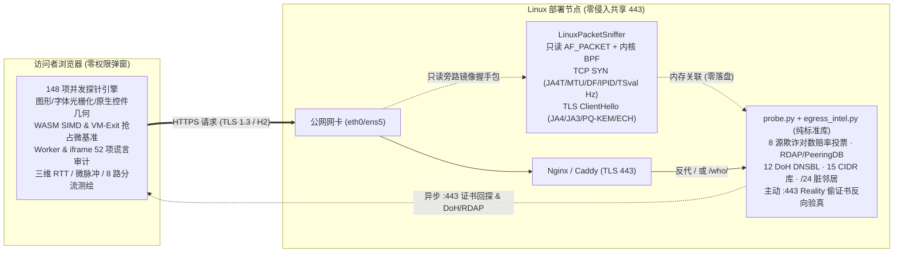

# WhoProbe v7.1 · 全栈浏览器指纹、协议栈深潜与多源出口信誉透视探针 (L3–L7)

[](./LICENSE)
[-3776AB.svg)](./probe.py)
[](#8-大观测层与-148-项真实探针)
[](#24-项跨层伪装与信誉交叉核验)

> **WhoProbe v7.1** 是一款**零第三方 Python 依赖**的全栈（L3 网络包头 → L4 传输与内核时钟 → 主动 `:443` 反向证书验真 → 多源 BGP/RIR/DNSBL 出口信誉 → HTTP 协议层 → 浏览器图形/硬件/防篡改运行时）指纹与代理伪装自检平台。
>
> **English Summary**: Zero-dependency Python + vanilla JS L3–L7 browser, protocol-stack & multi-source egress reputation inspector. Combines passive Linux `AF_PACKET` BPF sniffing (`TCP SYN` TTL/Window/MSS/MTU/`JA4T`/DF/IPID + `TSval` kernel `Hz` stateless SYN-spoof detection + `TLS ClientHello` `JA4`/`JA3`/GREASE/PQ-KEM/ECH), active `:443` VLESS-Reality stolen-certificate back-probing, 8-source weighted log-odds IP intelligence, BGP/RDAP/PeeringDB fake-ISP & lease detection, 12 DoH DNSBLs + 15 CIDR netsets + `/24` dirty-neighbour scoring, 6 business scenario suitability meters, and 148 client/server probes.

---

## 核心透视能力（为什么常规检测站看不穿你的破绽？）

常规「查看我的 IP」或纯前端指纹站只能看到单侧表层数据，而 **WhoProbe v7.1** 同时站在**服务端网卡底层、全球欺诈情报网与浏览器沙箱内部**做多维交叉审判：

1. **只读旁路抓包 + 跨包内核时钟防改包（L3/L4）**：通过只读 `AF_PACKET` + 内核 BPF 旁路嗅探 443 握手包（无需替换现有 Nginx），提取首个 `TCP SYN` 的初始 TTL、窗口、MSS/MTU、`JA4T` 及 `TLS ClientHello` (`JA4` / `JA3` / `X25519MLKEM768` / `ECH` / `ALPS`)；并跨包追踪 IPv4 `DF`、`IPID` 序列与 `TCP Timestamp (TSval)` 内核节拍频率 (`Hz`)，直接拆穿仅篡改首个 SYN 包的 `osfuscate` 无状态改包脚本。
2. **主动 `:443` 反向穿透与 VLESS-Reality 偷证书识别**：服务端异步回连出口 IP 的 `:443` 端口校验 TLS 证书——若非 Microsoft / Apple / Yahoo / Amazon / Cloudflare 官方 ASN 却返回上述大厂官网证书，直接实锤 **VLESS-Reality 借用证书伪装节点**。
3. **8 源对数赔率欺诈投票 + BGP/RDAP 伪家宽与脏邻居审计**：并发聚合 8 大独立 IP 情报家族，执行对数赔率加权投票 (`E = H / (H + N)`)；结合 RIPEstat / RIR RDAP / PeeringDB 识别「自报 ISP 但 PeeringDB 实为 Heavy Outbound 机房」的**伪家宽**、IPXO/InterLIR **商业租赁段**、**原生 IP vs 广播 IP**、RPKI ROA 签名、12 家实时 DoH DNSBL、15 份攻击/代理 CIDR 网段库及**同 `/24` C 段脏邻居连坐密度**；同时支持 `?ip=x.x.x.x` 检视任意外部公网 IP。
4. **三维物理测距 + 微脉冲粘包侧信道**：同时对比「服务端 TCP 握手 RTT」、「浏览器 HTTP 热连接 RTT」与「WebRTC STUN UDP 候选 RTT」，并用 6 组 `8ms` 微脉冲捕捉 Mux (`smux`/`yamux`) 多路复用粘包合并特征。
5. **跨系统字体光栅化、原生控件几何与虚拟化抢占抖动**：检测 Canvas 文字 RGB 次像素彩边率（Apple CoreText 灰阶 vs DirectWrite/FreeType LCD 彩边）、原生表单控件亚像素包围盒、滚动条占位宽度、WebCodecs 视频硬解芯片、WASM 128-bit SIMD 以及 60 组紧致时间片尾延迟比 (`p98/p50` Hypervisor VM-Exit 抢占抖动)，并叠加 52 项 JS 原型谎言、Worker/iframe 跨线程核验与 36 款 Chrome 扩展扫描。
6. **六大业务场景准入模拟 + 逐项「怎么改」修复指南**：实时计算 **AI 大模型、流媒体解锁、社媒注册养号、Turnstile/reCAPTCHA 免盾、金融支付反欺诈、SMTP 邮件投递** 六大场景通过率，每一处破绽均提供原理拆解、修复步骤与单条目即时「重测」。

---

## 架构概览



---

## 10 秒快速启动（零第三方依赖）

后端仅使用 **Python 3.10+ 标准库**（`probe.py` + `egress_intel.py`），前端采用双栏档案诊断台与四分页渐进工作区设计，已预编译内置 **Tailwind CSS v4**（零重型前端运行时依赖），无需安装任何 `pip` 包或 `Node.js` 即可直接启动：

```bash
git clone https://github.com/zzusec/whoprobe.git
cd whoprobe

# 1. 运行内置自动化自检（验证 TCP/JA4T/TSval 解析器、纯净度引擎与 HTTP 接口）
python3 probe.py --self-test

# 2. 启动服务（默认监听 http://127.0.0.1:8899）
python3 probe.py --host 0.0.0.0 --port 8899
```

打开浏览器访问 `http://127.0.0.1:8899`（同时原生兼容 `/who/` 子路径部署，并支持通过 `?ip=8.8.8.8` 或顶部搜索框查询任意公网 IP 信誉）。

---

## 生产环境部署指南（Linux 旁路抓包 + Nginx 共享 443）

推荐在 Linux 服务器上通过最小权限 `CAP_NET_RAW` 开启只读旁路嗅探，并用现有 Nginx 反代 `/` 或 `/who/` 子路径（不影响同域名下的其他业务）：

### 1. 部署代码与专用低权限系统用户

```bash
sudo git clone https://github.com/zzusec/whoprobe.git /opt/whoprobe
sudo useradd --system --no-create-home --shell /usr/sbin/nologin whoprobe
sudo chown -R whoprobe:whoprobe /opt/whoprobe
```

### 2. 配置 Systemd 服务（开启 `CAP_NET_RAW` 旁路抓包）

```bash
ip route show default
# 确认默认公网网卡名（如 eth0 或 ens5）

sudo cp /opt/whoprobe/deploy/who-probe.service /etc/systemd/system/who-probe.service
sudo sed -i 's/--sniff-iface eth0/--sniff-iface ens5/' /etc/systemd/system/who-probe.service
sudo systemctl daemon-reload
sudo systemctl enable --now who-probe
sudo systemctl status who-probe
```

### 3. 配置 Nginx 反向代理

参考 [`deploy/nginx-example.conf`](./deploy/nginx-example.conf) 配置子路径 `/who/` 或独立域名，测试并重载：

```bash
sudo nginx -t && sudo systemctl reload nginx
```

---

## Docker 部署

```bash
# 方式一：标准容器模式（快速体验）
docker compose up -d whoprobe

# 方式二：Host 网络 + NET_RAW 模式（开启宿主机 443 旁路抓包）
SNIFF_IFACE=ens5 docker compose --profile sniffer up -d whoprobe-sniffer
```

---

## 8 大观测层与 148 项真实探针

| 观测分层 | 探针数 | 核心检测项代表 |
| :--- | :---: | :--- |
| **1. 网络与协议栈 (`net`)** | 29 | 出口 IP、地理位置与坐标、ASN/ISP、出口类型、`TCP SYN→TLS` 物理握手 RTT、6 脉冲微突发粘包与抖动 (`muxjitter`)、IPv4 `DF`/`IPID`/`ECN` 与 `TSval` 内核时钟频率 (`ipquirk`)、`:443` Reality 偷证书反向验真 (`reality443`)、被动 TCP OS 推断、`JA4T`、MTU 隧道特征、`JA4` / `JA3` + GREASE、ALPS & 证书压缩、`X25519MLKEM768`、`ECH`、HTTP 头序哈希、QUIC/H3、递归 DNS 与多上游 `ECS` 子网审视 (`ecs`)、WebRTC STUN IP 与 UDP/TCP 时延差 (`udprtt`)、IPv6 EUI-64 MAC 泄露 |
| **2. 出口信誉与 BGP 情报 (`rep`)** | 11 | 出口纯净度评分与扣分账本 (`rep_score`)、8 源欺诈对数赔率加权投票 (`rep_votes`)、原生 IP vs 广播 IP 与多源共识 (`rep_native`)、BGP ASN 画像与 PeeringDB 伪家宽冲突 (`rep_asn`)、IPXO/InterLIR 商业租赁段识别 (`rep_lease`)、BGP 前缀规模与 RPKI ROA (`rep_rpki`)、Shodan 常驻端口与 CVE (`rep_shodan`)、OTX / StopForumSpam / Tor 威胁名录 (`rep_threat`)、12 家 DoH 实时 DNSBL (`rep_dnsbl`)、15 项恶意/代理 CIDR 库 (`rep_cidr`)、同 `/24` 脏邻居与全 ASN 滥用密度 (`rep_neigh`) |
| **3. 多路由分流矩阵 (`exit`)** | 8 | 本站直连、中国大陆测速节点、国际 GeoIP、OpenAI ChatGPT 边缘、Anthropic Claude 边缘、Cloudflare 边缘、Cloudflare WARP 隧道、IPv4/IPv6 双栈独立出口对照 |
| **4. HTTP 请求头 (`hdr`)** | 9 | 原始 `User-Agent` / `Accept-Language` / `Accept-Encoding`、`Sec-Fetch-*`、Client Hints 低熵与高熵真实系统版本/架构/位数、DNT 与 GPC |
| **5. 区域与语言 (`loc`)** | 11 | `navigator.languages`、IANA 时区、夏令时历史偏移签名、12/24 小时制、Intl 默认数字/货币/日历、`Intl.Collator` Unicode ICU 排序规则指纹 (`intlcoll`)、离线 TTS 语音包、物理键盘布局 |
| **6. 硬件与图形栈 (`dev`)** | 35 | 系统与内核真实版本、CPU 核数与架构、RAM/堆上限、物理面板分辨率与多屏扩展、P3/Rec2020/HDR、刷新率实测、WebGL 双显卡与硬件参数、WebGPU 双适配器与 Feature、音频栈、WASM SIMD 与 VM-Exit 抢占抖动 (`cpubench`)、原生表单控件亚像素几何 (`uigeom`)、跨系统字体光栅化彩边率与 Gamma (`fontrast`)、滚动条占位宽度、WebCodecs 硬解芯片、V8/Blink 真实版本下限测试 |
| **7. 浏览器与防篡改 (`brw`)** | 22 | 外观/对比度/动画无障碍媒体查询、无痕配额压制检测、权限静默状态、WebDriver/CDP 自动化痕迹、AdBlock 双重实测、注入扩展识别、36 款 Chrome 扩展 `chrome-extension://` 扫描、Web Worker 独立线程交叉核验、洁净 `iframe` 沙箱核验、52 项原生 API 谎言检测、防指纹护盾归因、7 大追踪器手动拦截实测 |
| **8. 跨站追踪指纹 (`fp`)** | 23 | 跨站综合指纹 ID、跨浏览器物理硬件码、无状态 HTTP `ETag` 缓存追踪、4 大浏览器存储复活测试、Canvas 2D 与 16×16 棋盘格隐蔽加噪陷阱、WebGL 着色像素回读、OfflineAudio 压缩与 ConstantSource 加噪陷阱、52 款字库画像、DOMRect/SVG/TextMetrics 亚像素指纹、超越函数数学库指纹、时钟粒度、可选硬件定位与传感器噪声实测 |

---

## 24 项跨层伪装与信誉交叉核验

包含 **20 项核心计分核验** + **4 项传输协议安全核验**：

1. 时区与出口 IP 对齐 (`tz`)
2. 浏览器首选语言与出口对齐 (`lang`)
3. 系统底层语种：字库 / 离线语音包 / 物理键位 (`syslang`)
4. 递归 DNS 解析器归属与 ECS 客户端子网泄漏 (`dns`)
5. 国内外与 AI 平台多路分流一致性 (`split`)
6. 底层 TCP/TLS 协议栈与自报系统一致性 (`conn`)
7. IP/TCP 跨包内核时钟连续性、防无状态改包与微脉冲粘包 (`synspoof`)
8. 出口 `:443` 反向验真与 VLESS-Reality 偷证书检测 (`reality`)
9. 往返延迟三维物理测距：TCP / HTTP / STUN UDP (`rtt`)
10. WebRTC STUN 真实公网 IP 与 IPv6 网卡 MAC 泄漏 (`webrtc`)
11. 出口 IP 机房 / 原生住宅 8 源加权投票 (`dc`)
12. 伪家宽自报冲突、商业 IP 租赁段与原生/广播属性 (`lease`)
13. 欺诈风险、12 项黑名单与同 `/24` 脏邻居连坐 (`reputation`)
14. 跨系统字体光栅化、原生控件与滚动条一致性 (`subpixel`)
15. 云主机虚拟化 CPU 抢占抖动与视频硬解芯片核验 (`hwvirt`)
16. 浏览器环境篡改、请求头矛盾与 52 项原型谎言检测 (`tamper`)
17. 指纹浏览器跨线程与内核版本语法矛盾 (`fpb`)
18. UA、高熵 Client Hints 与显卡渲染平台三方一致性 (`ua`)
19. 自动化控制框架与无头浏览器痕迹 (`bot`)
20. 跨站指纹固定度与无痕缓存追踪抗性 (`fp`)
21. 后量子混合密钥交换 PQ-KEM (`pq`) · 加密 ClientHello (`ech`) · HTTP/3 QUIC (`h3`) · Cloudflare WARP (`warp`)

---

## 后端接口与命令行参数

| 路径（同时支持 `/who` 前缀） | 说明 |
| :--- | :--- |
| `GET /` 或 `GET /who/` | 前端主界面（支持 `?ip=<public_ip>` 检视指定公网 IP 信誉） |
| `GET /api/who/me` | 返回客户端出口、GeoIP/ASN/PTR、Nginx TLS 元数据、HTTP 原始头序及旁路抓包捕获的 `packet.tcp` (`JA4T`/TTL/MTU/DF/IPID/`tsHz`) 与 `packet.tlsClientHello` (`JA4`/`JA3`/GREASE/PQ-KEM/ECH) |
| `GET /api/who/intel[?ip=...]` | 聚合 8 源欺诈/GeoIP 加权投票、RDAP/PeeringDB/RIPEstat ASN 与租赁审计、12 项 DoH DNSBL、15 项 CIDR 网段库、`/24` 脏邻居、Shodan/OTX/SFS/Tor 及 `:443` Reality 证书回探 |
| `GET /api/who/etag` | 零数据库无状态 HTTP `ETag` / `If-None-Match` 缓存追踪实测接口 |
| `GET /api/who/ping?seq=...` | 微秒级 `serverPerfUs` 单调时钟戳与微脉冲粘包/RTT 测距接口 |

```text
usage: probe.py [-h] [--host HOST] [--port PORT] [--sniff-iface SNIFF_IFACE]
                [--sniff-port SNIFF_PORT] [--no-active-probe] [--self-test]
```

---

## 致谢与灵感参考

- 多源对数赔率加权投票 (`log-odds` 信誉融合)、BGP/RDAP/PeeringDB 伪家宽与租赁段推断、DNSBL/CIDR 威胁网段聚合与 `/24` 脏邻居连坐评分，以及六大业务场景准入仪表盘的设计思路融合并致敬了开源项目 [**BlackSlience-Reaper/egress-observatory**](https://github.com/BlackSlience-Reaper/egress-observatory)。
- 前端界面采用双栏档案诊断台与四分页渐进式工作区信息架构，样式基于原生 Vanilla JS 与 [Tailwind CSS v4](https://tailwindcss.com/) 构建。

---

## 隐私与合规声明

- **零持久化日志**：[`probe.py`](./probe.py) 与 [`egress_intel.py`](./egress_intel.py) 不连接任何数据库、不落盘保存访问者 IP 或指纹日志；所有嗅探包头与情报缓存均保存在定长内存 `TTLCache` 中到期自动销毁。
- **合规用途**：本项目仅供网络安全研究、反欺诈风控原理解析、跨境网络排障及个人隐私暴露面自检使用。

## License

[MIT License](./LICENSE)
